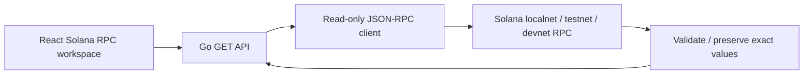

# IntentLedger Go API

Go 標準ライブラリだけで実装した、読み取り専用 Solana JSON-RPC バックエンドです。追加モジュール、DB、認証、ウォレット、秘密鍵、API キーは不要です。既定の接続先はローカル validator `http://127.0.0.1:8899`、commitment は `confirmed` です。

## 起動

Go **1.23 以上**（可能ならサポート中の安定版）を使用してください。

```sh
cd backend
go run ./cmd/server
```

`http://127.0.0.1:8080` で起動します。別ターミナルでリポジトリルートから `npm run dev` を実行し、サイドバーの **Solana RPC** を開きます。API server URL の既定値は `http://localhost:8080` です。公開アドレスで **Lookup account**、署名で **Get transaction** を押すと Go API を照会します。

会計例の合成アドレス・署名は実取引ではありません。接続中のクラスタに存在する公開アドレス／署名を入力してください。アカウントとして `11111111111111111111111111111111`（System Program）も照会できます。これはウォレットではなくプログラムアカウントで、SOL 残高は0でも正常です。

ビルドして起動する場合:

```sh
mkdir -p bin
go build -o bin/intentledger-api ./cmd/server
./bin/intentledger-api
```

### この作業環境の Go 設定

実装時の環境では `go` が 1.17.8、`GOROOT` はインストール済み 1.27.0 を指しており不一致でした。ホストの設定は変更せず、検証には `$GOROOT/bin/go`（1.27.0）を使用しています。同じ状態なら、次のコマンドで一致するバイナリを使えます。

```sh
"$GOROOT/bin/go" run ./cmd/server
"$GOROOT/bin/go" test -race ./...
```

通常の Go 環境では前述の `go run` / `go test` を使ってください。

## HTTP API

すべて `GET` です。`OPTIONS` は CORS 用に対応します。送信・署名・airdrop 用 API と任意メソッドのプロキシは実装していません。

| エンドポイント | 対応 RPC | 内容 |
| --- | --- | --- |
| `/api/v1/health` | RPC を呼ばない | Go API の稼働と設定クラスタを確認 |
| `/api/v1/solana/balance?address=<pubkey>` | `getBalance` | native SOL 残高 |
| `/api/v1/solana/signatures?address=<pubkey>&limit=10` | `getSignaturesForAddress` | アドレスを参照する最近の署名。limit は1〜100、既定10 |
| `/api/v1/solana/transactions/<signature>` | `getTransaction` | 実行状態、手数料、元の parsed JSON |

```sh
curl http://localhost:8080/api/v1/health
curl 'http://localhost:8080/api/v1/solana/balance?address=11111111111111111111111111111111'
curl 'http://localhost:8080/api/v1/solana/signatures?address=11111111111111111111111111111111&limit=1'
```

成功レスポンスの形:

```json
{
  "data": {
    "address": "11111111111111111111111111111111",
    "lamports": "0",
    "sol": "0",
    "slot": "123"
  },
  "cluster": "localnet",
  "commitment": "confirmed"
}
```

これは形式の例であり、実接続結果ではありません。`lamports`、`slot`、`feeLamports` は整数精度を維持するため文字列です。`sol` も整数演算から生成した文字列です。`rawJSON` は RPC result 全体の **JSON 文字列** で、JavaScript で再パースしない限り大きな整数も丸められません。

取引取得は `encoding: "jsonParsed"` と `maxSupportedTransactionVersion: 1` を指定します。legacy／v0／v1 を読み取り、v1 の `transactionConfig` も元の JSON に保持します。[Solana の公式移行情報](https://solana.com/upgrades/larger-transaction-sizes)

`status` は、meta.err が null なら `confirmed`、実行エラーがあれば `failed`、meta が null なら `unknown` です。これは **実行結果** であり、BRIDGE／SWAP などの意味分類ではありません。

エラーの形:

```json
{
  "error": {
    "code": "TRANSACTION_NOT_FOUND",
    "message": "Transaction not found on this cluster at confirmed commitment. It may be pending or outside the node's retained history."
  }
}
```

| HTTP | code | 意味 |
| --- | --- | --- |
| 400 | INVALID_INPUT | base58 の文字・デコード後32／64バイト長、limit が不正 |
| 403 | ORIGIN_NOT_ALLOWED | 許可していないブラウザー origin |
| 404 | TRANSACTION_NOT_FOUND | 未確認、別クラスタ、または保持履歴外などで RPC result が null |
| 404 | NOT_FOUND | API ルートが存在しない |
| 405 | METHOD_NOT_ALLOWED | GET／OPTIONS 以外 |
| 502 | RPC_UNAVAILABLE / RPC_INVALID_RESPONSE | 上流障害または不正レスポンス |
| 503 | RPC_RATE_LIMITED | RPC が HTTP 429 を返した。Retry-After: 5 |
| 504 | RPC_TIMEOUT | RPC タイムアウト |

RPC リクエストには10秒の期限があり、レスポンスサイズは2 MiBまでです。JSON-RPC version／request ID、整数、必須フィールド、実行エラー形式、timestamp を検証します。プロバイダーの内部エラーメッセージは HTTP レスポンスへ転送しません。画面のリクエストにも12秒の期限があり、画面移動や入力変更時にはキャンセルし、古い結果の上書きを防ぎます。

## 環境ごとの設定

| APP_ENV / -env | 既定クラスタ | 既定 RPC |
| --- | --- | --- |
| local（未指定時） | localnet | http://127.0.0.1:8899 |
| online | testnet | https://api.testnet.solana.com |

ローカルでは別ターミナルで `solana-test-validator` を起動してください（Solana CLI は別途必要です）。

```sh
# ローカル
APP_ENV=local go run ./cmd/server

# オンライン環境
APP_ENV=online HTTP_LISTEN=:8080 ALLOWED_ORIGINS=https://<owner>.github.io go run ./cmd/server

# フラグでも指定可能
go run ./cmd/server -env online

# devnet も明示指定で引き続き利用可能
SOLANA_CLUSTER=devnet go run ./cmd/server
```

優先順位は **フラグ > 対応する環境変数 > 環境に応じた既定値** です。
環境は自動推測せず、デプロイ先で `APP_ENV=online` を設定します。

| 環境変数 | フラグ | 内容 |
| --- | --- | --- |
| APP_ENV | -env | local / online |
| SOLANA_CLUSTER | -cluster | localnet / devnet / testnet。指定するとクラスタの既定 URL も切り替わる |
| SOLANA_RPC_URL | -rpc-url | 独自 RPC URL。クラスタラベルと実際の接続先を一致させること |
| HTTP_LISTEN | -listen | 既定127.0.0.1:8080。コンテナ等では :8080 |
| ALLOWED_ORIGINS | -allowed-origins | カンマ区切りの完全一致 origin。既定 localhost:5173 / 127.0.0.1:5173 |

空の環境変数は未設定として扱います。不正な環境名・クラスタ・URL は起動時にエラーとなります。
`SOLANA_RPC_URL` を独自指定した場合、その URL のクラスタは自動検証しません。
CORS は認証機能ではありません。Origin ヘッダーのない curl 等は利用できます。

testnet の公開 RPC は [Solana 公式資料](https://solana.com/docs/references/clusters) の接続先を使用します。

## GitHub Pages と組み合わせる

フロントエンドは従来どおり静的サイトとして公開できます。**Go API は GitHub Pages では実行できないため、別ホストへ配置します。**

1. Go API を HTTPS で到達できる環境へ配置します。TLS はホスティング側または reverse proxy で終端します。
2. Go の `-allowed-origins` に `https://<owner>.github.io` を追加します。リポジトリのサブパスは origin に含めません。
3. フロントエンドの **API server URL** に `https://<api-host>` を入力します。reverse proxy のプレフィックス（例: `https://<host>/intentledger`）にも対応しています。

設定は実行時の入力で、ビルド環境変数や秘密情報は不要です。未接続でも既存の4会計シナリオは利用できます。ページ表示だけで RPC 呼び出しは発生しません。**Check API** はバックエンドの稼働確認であり、Solana RPC の稼働確認ではありません。

本変更では API の公開デプロイ、認証、永続化、キャッシュ、ユーザーごとのクォータを実装していません。

## テスト

```sh
go test -race -cover ./...
go vet ./...
go build ./cmd/server
```

テストは HTTP transport の差し替えと `httptest.ResponseRecorder` を使用し、サーバーの待受・外部 RPC 接続なしで動きます。GitHub Actions の `backend.yml` でも実行します。

公開 devnet の読み取りを実際に試す任意の smoke test:

```sh
go test -run TestClient_live_devnet_reads -v ./internal/solana -args -live-rpc
```

通常のテストではこの smoke test をスキップします。公開 RPC のレート制限・ネットワーク・保持履歴に依存します。今回の実行環境では DNS 制限で失敗しており、ライブ接続の成功は未確認です。またサーバーの待受も環境で拒否されたため、HTTP listener を使った end-to-end 確認は未実施です。詳細は `../docs/verification.md` とログを参照してください。

## 構成



- `internal/config/config.go`: 環境設定と優先順位の解決。
- `cmd/server/main.go`: フラグ、HTTP timeout、SIGINT／SIGTERM 時の終了処理。
- `internal/api/handler.go`: 固定ルート、CORS、API エラー。
- `internal/solana/client.go`: リクエスト、レスポンス検証、DTO。
- `internal/solana/live_test.go`: 任意の公開 devnet smoke test。

native SOL 残高とアカウント参照履歴を読む最初の接続層です。SPL Token／Token-2022 の全保有残高や ATA を含む完全履歴、DeFi instruction の解釈、実データと UI intent の相関、意味レコード API は今後の実装対象です。
